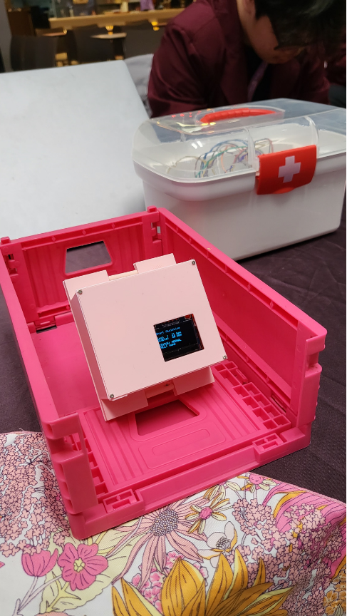

# Assistive Smart Bracelet

A wearable bracelet for elderly users that monitors **heart rate** and **stability (fall detection)**, and alerts through a buzzer, LED, and OLED display. Built on an AVR microcontroller (Arduino Nano / ATmega328P) with bare-metal C/C++ drivers (no Arduino libraries).



> ⚠️ **Status: Prototype.** Under active development. Pins, thresholds, and code structure may change. This project is **not a medical device** and must not be used for diagnosis.

## Project Scope
Many commercial smartbands (e.g. Samsung Galaxy Fit 3, Xiaomi Watch 2) offer heart rate monitoring and fall detection, but rely on a smartphone app or network connection for emergency alerts. This prototype is a **standalone embedded system**: it measures, decides, and alerts on the device itself, with no internet, mobile app, or IoT backend.

## Features
- Heart rate (BPM) monitoring with the MAX30102 sensor (instant and stabilized BPM)
- Fall detection with the MPU6050 accelerometer (free-fall followed by impact)
- Live status on a 128x64 SSD1306 I2C OLED
- Distinct buzzer + LED patterns for each condition (see below)
- Battery powered, boosted to 5V with an MT3608 step-up converter

## Alert Patterns
Each alert lasts **3 seconds**. The LED blinks together with the buzzer.

| Condition | Trigger | Buzzer / LED pattern |
|-----------|---------|----------------------|
| Normal | Heart rate in range, no fall | Silent, LED off |
| Abnormal heart rate | Stable BPM below **60** or above **100** | 100 ms on / 400 ms off (slow beeps) |
| Fall | Free-fall followed by an impact | 100 ms on / 100 ms off (fast beeps) |
| Both | Fall detected while the heart rate alarm is active | 50 ms on / 50 ms off (very fast beeps) |

## Hardware
| Component | Qty | Purpose |
|-----------|-----|---------|
| Arduino Nano (ATmega328P) | 1 | Main microcontroller |
| MPU6050 (GY-521) | 1 | Motion and fall detection (I2C, 0x68) |
| MAX30102 | 1 | Heart rate sensor (I2C, 0x57) |
| SSD1306 128x64 OLED (I2C) | 1 | Status display (I2C, 0x3C) |
| Active buzzer | 1 | Audible alert (D5) |
| Red LED + 1k resistor | 1 | Visual indicator (D7) |
| 5k pull-up resistor | 2 | SDA and SCL pull-ups |
| MT3608 boost converter | 1 | Boosts battery voltage to 5V |
| LiPo battery 3.7V 1000 mAh + JST-PH 2-pin connector | 1 | Power source |

Full list: [`hardware/bom.csv`](hardware/bom.csv)

## Wiring
| Device | Pin | Arduino Nano Pin |
|--------|-----|------------------|
| MPU6050 / MAX30102 / OLED | SDA / SCL | A4 / A5 |
| Buzzer | + | D5 |
| LED (via 1k) | Anode | D7 |
| MT3608 | Vout+ | VIN (5V) |

All three I2C devices share one bus. Details and notes: [`docs/wiring.md`](docs/wiring.md)

Schematic (EasyEDA): [`hardware/schematic/schematic.png`](hardware/schematic/schematic.png)

Enclosure (STL, approx. 89 x 74 x 43 mm): [`hardware/enclosure/Casing.stl`](hardware/enclosure/Casing.stl)

## Getting Started
Full guide: [`docs/setup.md`](docs/setup.md). In short, using [PlatformIO](https://platformio.org/):

```bash
git clone https://github.com/JuliusLK/assistive-smart-bracelet.git
cd assistive-smart-bracelet/firmware
pio run -t upload
```

No external libraries are needed. All drivers (I2C, SSD1306, MAX30102, MPU6050) are included in `firmware/src/`.

## How It Works
A short overview is below; see [`docs/how-it-works.md`](docs/how-it-works.md) for details.

- **Heart rate:** the MAX30102 IR signal is compared against an adaptive baseline to detect beats. Beat-to-beat intervals are filtered (median + trimmed mean over the last 5 beats) to produce a stable BPM.
- **Fall detection:** the accelerometer magnitude is sampled every 50 ms. A fall is flagged when a free-fall phase (< 0.6 g for 3 samples) is followed within 1 s by an impact (> 2.5 g, or a sudden jump of more than 1.5 g).

## Test Results
| Test | Result |
|------|--------|
| Heart rate vs. Samsung Galaxy Fit 3 (10 readings, all above 100 BPM) | Mean 116.2 vs 114.4 BPM, 1.57% difference of the means (3.0 BPM mean absolute difference) |
| Simulated falls (10 trials) | 10 / 10 detected, alarm triggered every time |

Details and limitations: [`docs/test-results.md`](docs/test-results.md)

## Repository Structure
```
assistive-smart-bracelet/
├── firmware/
│   ├── platformio.ini
│   └── src/             # main.cpp + drivers (i2c, lcd, font, mpu6050, max30105, heartrate, millis)
├── hardware/
│   ├── schematic/       # Circuit schematic
│   ├── enclosure/       # Enclosure design (Casing.stl)
│   └── bom.csv          # Bill of materials
├── docs/                # Wiring, setup, how it works, test results, calibration, photos
└── .github/             # Issue templates
```

## Roadmap
- [x] MAX30102 heart rate measurement
- [x] MPU6050 fall detection
- [x] Condition-based buzzer/LED alerts
- [x] OLED status display
- [x] Initial enclosure design
- [ ] Heart rate sensor calibration (see [`docs/calibration.md`](docs/calibration.md))
- [ ] MPU6050 calibration (accelerometer offsets, use of gyro bias)
- [ ] More compact design (smaller PCB, wrist-sized enclosure)
- [ ] Power optimization (sleep modes)
- [ ] Testing with more users and everyday-activity scenarios (false-alarm rate)
- [ ] Optional wireless notifications, keeping the standalone mode

## Known Issues
- BPM readings are sensitive to motion and sensor pressure on the skin
- Fall thresholds are fixed constants and not yet validated across many scenarios
- Fall tests so far only cover simulated falls, not everyday activities, so the false-alarm rate is unknown
- Gyro bias is computed at startup but not yet used in fall detection
- The heart rate alarm state is only updated when a beat is detected, so it may stay active after the finger or wrist loses contact with the sensor
- I2C error handling is minimal (return codes are mostly ignored)
- Device is still bulky because it uses separate modules (the prototype enclosure is about 89 x 74 x 43 mm)

## Authors
Final project for **CPEN6261010 Microcontroller** (class LC40), Computer Engineering, Binus University, odd semester 2025/2026.

- Azalia Varsha Jeslyn Putri Legowo
- Julius Lim Khan ([@JuliusLK](https://github.com/JuliusLK))

Demo video, datasheets, and source code: [Google Drive folder](https://drive.google.com/drive/folders/1rcAn8aaCPUsQuGYYnXUqQ4JUi0sYIxXf?usp=sharing)

## Contributing
Pull requests are welcome. For major changes, please open an issue first.

## License
The firmware is released under the **GNU GPL v3.0 or later** ([LICENSE](LICENSE)), because it includes an OLED driver derived from GPL-licensed code (see Acknowledgements). Hardware and enclosure designs: consider CERN-OHL or CC BY-SA.

## Acknowledgements
- `millis.cpp` is based on [avr-millis-function](https://github.com/monoclecat/avr-millis-function) by Monoclecat.
- The MAX30102 driver follows the register layout and API style of the SparkFun MAX3010x library.
- The SSD1306 OLED driver (`lcd.c`, `lcd.h`, `font.c`, `font.h`) is derived from [Sylaina/oled-display](https://github.com/Sylaina/oled-display) by Michael Köhler (Skie-Systems), licensed under GPL-3.0-or-later and modified for this project.

## Disclaimer
This device is an educational and research prototype. It has not been clinically validated and does not replace medical equipment or professional healthcare supervision.
