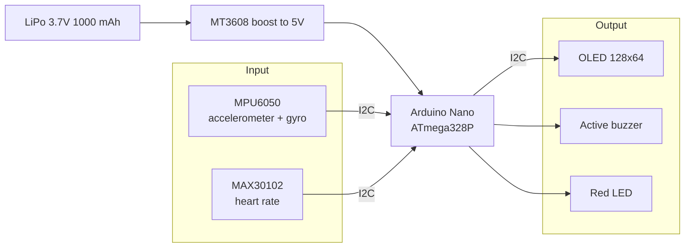
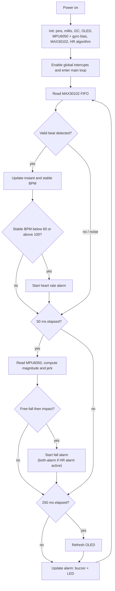

# How It Works

## System block diagram


## Main loop flowchart


## Main loop (`firmware/src/main.cpp`)
1. **Init:** Timer1 millis, I2C (100 kHz), buzzer/LED pins, OLED, MPU6050, gyro bias calibration (200 samples), MAX30102.
2. **Heart rate:** read the MAX30102 FIFO, feed each IR/Red sample to `hr_process()`. On each detected beat, the stable BPM is checked against the allowed range.
3. **Motion:** every 50 ms, read the accelerometer and run the fall state machine.
4. **Display:** refresh the OLED every 250 ms (and on fall state changes).
5. **Alarm:** a non-blocking alarm state machine toggles the buzzer and LED.

## Heart rate algorithm (`heartrate.cpp`)
- The IR signal is compared with an adaptive baseline (IIR filter) plus a dynamic offset to find rising edges.
- A refractory period (250 ms) and hysteresis prevent double counting.
- Beats are validated by a minimum amplitude and by Red/IR correlation.
- IR below `10000` is treated as "no finger / no contact" and resets the state.
- Beat-to-beat intervals (RR) between 300 and 2000 ms are stored in a window of 5. The **stable BPM** is a trimmed mean (within ±20% of the median); the **instant BPM** is computed from the latest interval. Values outside 30-220 BPM are discarded.

## Fall detection (`main.cpp`)
Accelerometer magnitude (in g) is sampled every 50 ms:

```
IDLE --(mag < 0.6 g)--> POSSIBLE_FALL
POSSIBLE_FALL --(3 consecutive samples < 0.6 g)--> WAIT_IMPACT
POSSIBLE_FALL --(mag >= 0.6 g)--> IDLE
WAIT_IMPACT --(mag > 2.5 g or jerk > 1.5 g)--> ALARM, back to IDLE
WAIT_IMPACT --(no impact within 1000 ms)--> IDLE
```

If the heart rate alarm is already active when a fall is detected, the **both** pattern is used.

## Alarm patterns
| Type | Buzzer on / off | Duration |
|------|-----------------|----------|
| Heart rate | 100 ms / 400 ms | 3 s |
| Fall | 100 ms / 100 ms | 3 s |
| Both | 50 ms / 50 ms | 3 s |

## Sensor configuration
| Sensor | Setting |
|--------|---------|
| MPU6050 | Accelerometer ±2 g, gyroscope ±2000 °/s, sample-rate divider 7, no DLPF |
| MAX30102 | LED power `0xDF`, averaging 2, Red + IR, 200 Hz sample rate, 411 µs pulse width, 16384 ADC range |
